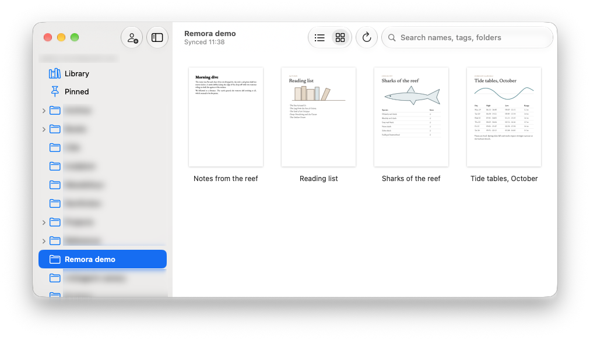
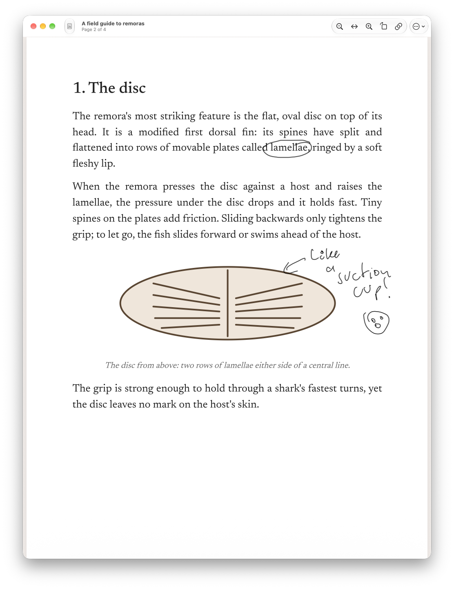
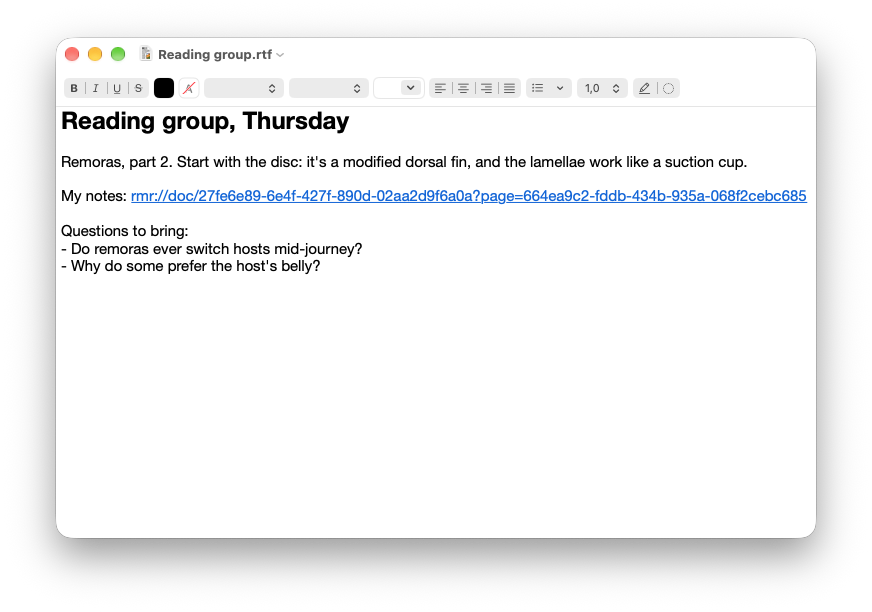
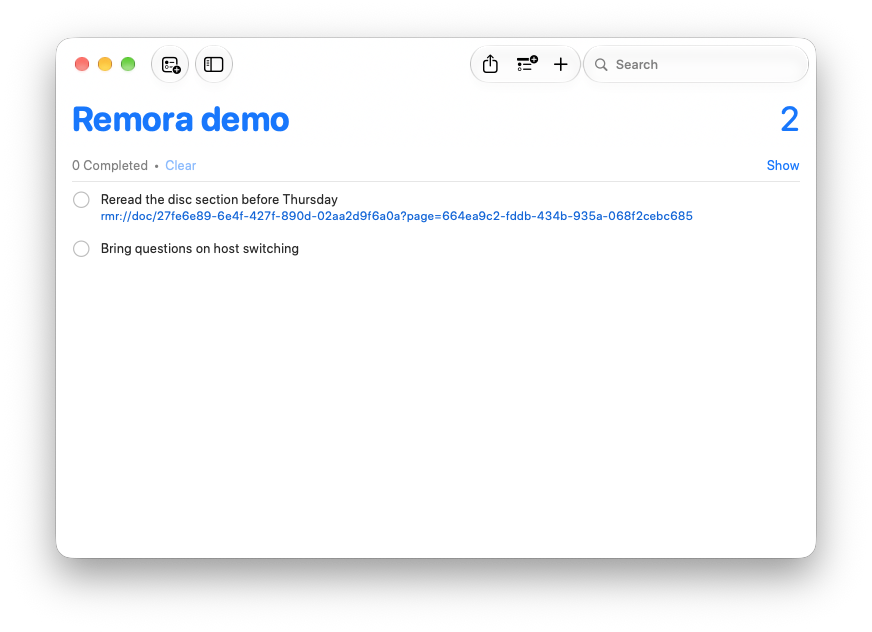

<p align="center"></p>

# Remora

A native Mac reader for your reMarkable cloud. Notebooks, PDFs and EPUBs with your ink on them, live while you write, and a stable link to every page.

Remora is the fish that rides along on something bigger.

<p align="center"></p>

## Why

Most of my thinking happens on the tablet: meeting notes, sketches, the margins of whatever I'm reading. My other notes live on the Mac, and I wanted the two to meet. So Remora gives every page an address. Copy a link to page 3 of yesterday's meeting, paste it into a note, and a click later the page is in front of you, with whatever you've added since.

## What it does

- **A link to every page.** Every document, folder and page has a stable `rmr://` link. Copy Link to Page (⌘L) or Copy as Markdown Link, then paste it into Obsidian, Bear, a calendar invite or a to-do. Clicking it opens Remora at that page, or scrolls the window that's already open. Links name no account and no title, so they keep working when you rename or move things.
- **Drag it anywhere.** Drag a document or folder out of the library into another app and it lands as a titled link: a rich link in Notes or Mail, a Markdown link in a plain text field.
- **Live while you write.** An open notebook redraws as the tablet syncs: only the pages that changed, keeping your place and zoom. If the edit happened on a page you can't see, Remora offers to jump to it.
- **Notebooks** with your ink, coloured and pressure-sensitive, on their lined, grid or dotted templates, typed text included.
- **PDFs and EPUBs** with ink and highlights where you put them. Links inside a PDF and an EPUB's table of contents work.
- **The library** as a list or as thumbnails: folders, pinned items, and search across names, tags and folder paths. Several accounts side by side.
- **Fast, and offline.** Remora opens from its cache, then syncs. Whatever it has seen before is there without a connection.

<p align="center"></p>

Remora is a reader. It never edits what you've written.

## Install

With Homebrew:

```sh
brew install --cask openparen/tap/remora
```

Or download `Remora-<version>.dmg` from [Releases](https://github.com/openparen/remora/releases), open it, and drag Remora into Applications. The app is signed and notarized.

**You need** macOS 26 or later, and a reMarkable account with cloud sync (Connect).

**Pairing:** on first launch, Remora asks for a one-time code from [my.remarkable.com/device/desktop/connect](https://my.remarkable.com/device/desktop/connect). It then shows up in your account as a desktop app.

## Links

```
rmr://doc/<document-id>
rmr://doc/<document-id>?page=<page-id>
rmr://folder/<folder-id>
```

Ids are reMarkable's own, so a link survives renames, moves and page reordering. A link to a page that was deleted opens the document and says so.

<p align="center"> </p>

## Privacy

- Remora talks to reMarkable's cloud and nothing else. No server of mine, no account, no analytics.
- The device token lives in your Mac's Keychain. Downloaded files are cached in `~/Library/Caches/Remora`, and removing an account deletes its cache.

## The fine print

Remora uses reMarkable's cloud the way their own apps do. There's no official API for this, so a change on their side can break it until it's fixed here. If that happens, please [open an issue](https://github.com/openparen/remora/issues).

## Building from source

You need Xcode 26 and [XcodeGen](https://github.com/yonaskolb/XcodeGen) (`brew install xcodegen`).

```sh
scripts/build-app.sh            # prints the path of the built Remora.app
swift test --package-path RMKit # the core's tests
```

The default build is ad-hoc signed. It works, but macOS then asks for Keychain access after every rebuild, because each build looks like a new app. To avoid that, sign with your own identity: `REMORA_SIGN_IDENTITY="Apple Development" REMORA_TEAM=<team id> scripts/build-app.sh`. `scripts/release.sh` makes a notarized release; see its header.

## How it's put together

- `RMKit/`: the core, a Swift package with no UI.
  - the reMarkable sync protocol (v3/v4) and a content-addressed blob cache;
  - the `.rm` parser for v3, v5 and v6, with highlights, typed text and anchors;
  - page templates, rendering, and ink placement on PDF pages.
- `App/`: the SwiftUI app, on top of PDFKit for PDFs.
- `docs/plans/`: the design, and what each stage built and why.

## Thanks

Remora stands on the shoulders of people who worked out reMarkable's formats in the open, especially [rmscene](https://github.com/ricklupton/rmscene) and [rmc](https://github.com/ricklupton/rmc) by Rick Lupton. Parts of RMKit are ported from [rmapi-js](https://github.com/erikbrinkman/rmapi-js) by Erik Brinkman, and its tests use rmscene's sample files. Their licenses are in [THIRD_PARTY_NOTICES.md](THIRD_PARTY_NOTICES.md).

## License

MIT, see [LICENSE](LICENSE). Bug reports are very welcome, especially from accounts and tablets that aren't mine.

reMarkable® is a registered trademark of reMarkable AS. Remora is an independent open-source app, not affiliated with or endorsed by reMarkable AS.
